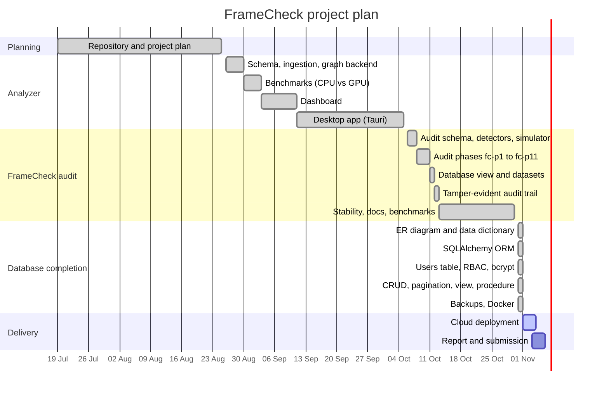
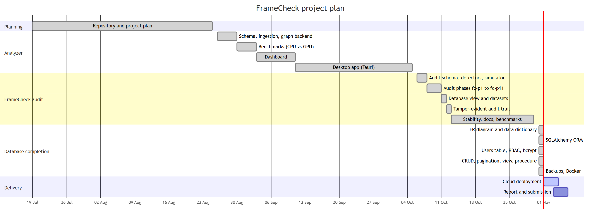

# FrameCheck: Project Proposal

**Course:** BCSE307L Database Systems

## Title

**FrameCheck: a GPU-accelerated Ethereum transaction-graph analyzer and framing audit**

## Problem statement

On Ethereum, anyone can send funds to any wallet, and the receiver cannot refuse them. That makes the transaction graph easy to manipulate from outside: an attacker can make an innocent wallet look connected to a hack just by sending it small "dust" transfers. Analysis tools that flag wallets by their proximity to known bad actors can therefore be made to flag someone who did nothing.

FrameCheck audits every flag its detectors raise and answers two questions: **could an outsider have produced this flag without the wallet owner doing anything, and how cheaply?**

A flag is **frameable** if it still holds with every transaction signed by the wallet removed, because unsolicited inbound transfers alone were enough to produce it. It is **robust** if it disappears, because it depended on the wallet's own signed behaviour, which an attacker cannot forge.

**Prior work.** FrameCheck builds on Liu et al., "Evasion Under Blockchain Sanctions" (WWW '26), which introduced dusting attacks and the proportional impurity score (`impurity_wei / balance_wei`). That score is one of the detectors FrameCheck audits. FrameCheck does not claim to have invented dusting attacks, taint models or counterfactual explanations.

## Objectives

1. Ingest a bounded Ethereum subgraph from Etherscan into a normalized PostgreSQL schema.
2. Run PageRank, Louvain and BFS on graph snapshots, on the GPU (cuDF + cuGraph) with a CPU fallback (pandas + NetworkX), and measure the difference honestly.
3. Raise flags with five detectors: BFS proximity, Sybil cluster, PageRank threshold, impurity and engaged proximity.
4. Audit each flag as frameable or robust, with a framing cost where one exists (an upper bound unless the method is `exact`).
5. Make the audit trail tamper-evident in the database itself, using a hash chain, append-only triggers and system-versioned flags.
6. Deliver a secure, role-based web dashboard and desktop app, with CRUD, search and pagination, deployed in the cloud.

## Scope

**In scope**

- Ethereum mainnet, native ETH and ERC-20 transfers, through a bounded 2-hop crawl around a case-study address.
- A PostgreSQL schema of 25 tables, with triggers, functions, a view, a materialized view and stored procedures.
- SQLAlchemy ORM data access, with DDL in SQL migrations.
- Google sign-in and bcrypt local accounts, with admin, analyst and viewer roles.
- A FastAPI backend, a browser dashboard and a Tauri desktop app.
- Backup and verified restore with `pg_dump` / `pg_restore`.
- Docker, docker compose and cloud deployment.
- A framing **simulator** that only inserts synthetic rows into a local database, tagged `is_simulated`.

**Out of scope**

- Internal (contract-initiated) transactions. Ingestion never calls Etherscan's `txlistinternal`, so these transfers are invisible to the pipeline and to every audit built on it. This is a known limitation.
- Other blockchains.
- Crawls beyond the configured hop and transaction limits.
- Sending real transactions. Framing is simulation only.
- Attributing wallets to real-world identities.
- Exact minimum framing costs in general: greedy results are reported as upper bounds.

## Team members and responsibilities

| Member | Register number | Responsibilities |
|---|---|---|
| Vishal Muthukrishnan | 24BCE2802 | `<responsibilities>` |
| Shalom Santosh | 24BCE2731 | `<responsibilities>` |

## Technology stack (as built)

| Layer | Technology |
|---|---|
| Database | PostgreSQL 16+, PL/pgSQL triggers, functions and procedures |
| ORM | SQLAlchemy 2.x over psycopg2 |
| Backend | Python, FastAPI, Uvicorn |
| Graph analytics | cuDF + cuGraph (GPU, RAPIDS in WSL2); pandas + NetworkX (CPU) |
| Frontend | HTML, CSS and JavaScript with no build step; WebGL graph view |
| Desktop | Tauri 2 (Rust) with a PyInstaller-frozen backend sidecar; wgpu layout |
| Authentication | Google OAuth 2.0 (PKCE), bcrypt local accounts, role-based access control |
| DevOps | Docker, docker compose, Docker Hub (private), GitHub Actions, Render, Neon |

## Major deliverables

| Deliverable | Where |
|---|---|
| Source code | GitHub repository `LIVIDFOX1116/DBMS` (private), branch `dev` |
| Schema DDL and migrations | [`db/schema.sql`](../db/schema.sql), [`db/migrations/`](../db/migrations/) |
| ER diagram | [`ER_Diagram_TransactionGraphAnalyzer.svg`](ER_Diagram_TransactionGraphAnalyzer.svg) / [`.png`](ER_Diagram_TransactionGraphAnalyzer.png), from [`schema_v2.dbml`](schema_v2.dbml) |
| Data dictionary | [`DATA_DICTIONARY.md`](DATA_DICTIONARY.md) |
| ORM layer | [`db/orm/`](../db/orm/) |
| API reference, ORM coverage | [`API_CONTRACT.md`](API_CONTRACT.md) |
| Audit method and results | [`FRAMECHECK.md`](FRAMECHECK.md), [`RESULTS.md`](RESULTS.md) |
| GPU vs CPU benchmarks | [`benchmark_results.md`](benchmark_results.md) |
| Backup and restore | [`BACKUP_RESTORE.md`](BACKUP_RESTORE.md), `scripts/backup_db.*`, `scripts/restore_db.*` |
| Container image | [`Dockerfile`](../Dockerfile), [`docker-compose.yml`](../docker-compose.yml) |
| Desktop app | [`src-tauri/`](../src-tauri/) (Windows installer) |
| Live URL | <https://framecheck-awlf.onrender.com> (sign-in required) |

## Gantt chart

Completed work uses actual dates from git history and tags (`fc-p1` to `fc-p11`). Deployment and submission are planned dates.

